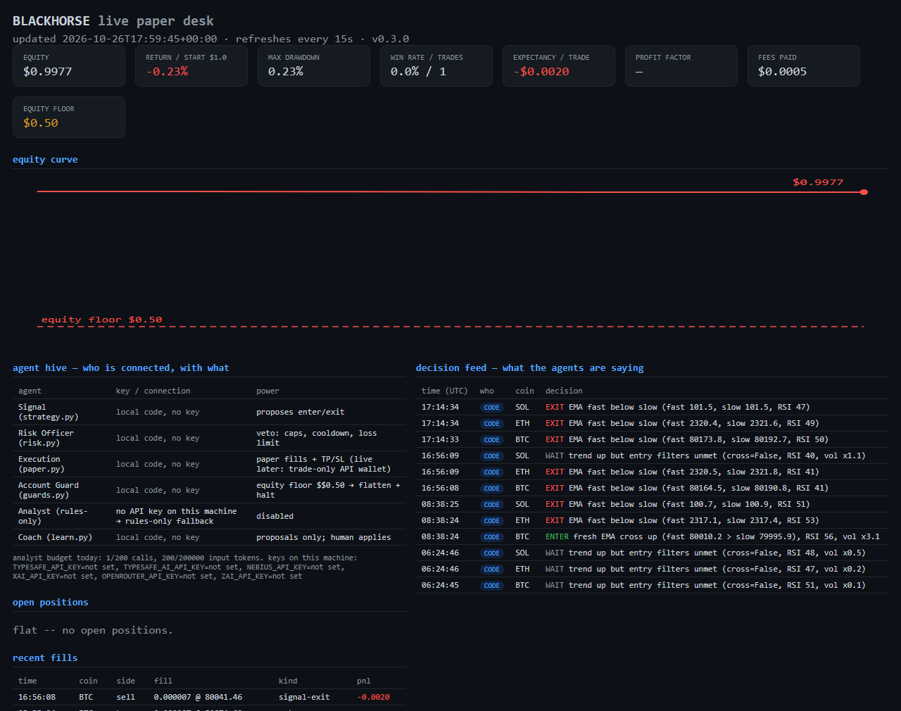

<div align="center">

# 🐎 Blackhorse Trading

### A $10 AI trading desk that refuses to go below $5 — with receipts, not screenshots.

[](https://www.python.org)
[](#-the-ladder-paper--testnet--mainnet)
[](requirements.txt)
[](LICENSE)
[](#-where-keys-go-and-where-they-never-go)

**Paper-trades crypto against live Hyperliquid prices • localhost dashboard • AI veto layer • walk-forward learning**

*Educational software — not financial advice. Perps can liquidate 100% of an account.*



</div>

---

## 📖 Table of Contents

- [Why this exists](#-why-this-exists)
- [Quick Start](#-quick-start-no-account-no-keys-no-money)
- [The Dashboard](#-the-dashboard-what-is-happening-right-now)
- [The Agent Hive](#-the-agent-hive-who-does-what)
- [Where keys go](#-where-keys-go-and-where-they-never-go)
- [The Ladder](#-the-ladder-paper--testnet--mainnet)
- [How it learns](#-how-it-learns-honestly)
- [Repo comparison](#-how-it-compares-to-the-public-repos)
- [Honest numbers](#-honest-numbers)
- [India note](#-india-note)

## 🎯 Why this exists

X.com is full of *"Grok bot turned $14 into $7,643"* screenshots. We checked —
they're survivorship bait (even [Grok itself debunked one](https://x.com/sector_sol/status/2114260024675741783)).
The **one transparent public experiment** ($10,000, 22 hours, real account, on
camera) made **$0.84**.

So this project is built the boring, honest way:

- **Deterministic strategy core** (EMA cross + RSI + volume) — every signal replayable
- **Risk enforced in code, never in prompts** — the LLM can veto a trade, never place one
- **Everything journaled** — every decision, fill, and equity mark in SQLite
- **AI = referee, not gambler** — Jev/Nebius may only say "skip"; they never size or execute
- **A floor that halts the bot**: `$10 in → equity touches $5 → everything flattens`

## ⚡ Quick Start (no account, no keys, no money)

```bash
pip install -r requirements.txt   # requests + hyperliquid sdk — that's all
```

| Double-click | What happens |
|---|---|
| 🟢 `run_paper.bat` | **paper-trades live crypto prices** with simulated money. Leave the window open. |
| 📊 `run_dashboard.bat` | opens **http://127.0.0.1:8765** — watch the agents work |
| 🧾 `run_report.bat` | scoreboard: equity, win rate, profit factor, drawdown, fees |
| 🧠 `run_learn.bat` | walk-forward parameter search → `learned_proposals.json` |
| 🩺 `doctor.bat` | pre-flight: python, API, config, DB, keys, ports, testnet |
| 🔑 `connect_wallet.bat` | **one-time**: paste your testnet API key (hidden prompt) → auto-saves, verifies, shows balances |
| 🤖 `analyst_test.bat` | fires **one real call** at Jev/Nebius — proves your AI key works |
| 🧪 `testnet.bat` | **real signed orders, mock money** on Hyperliquid testnet |
| 🔓 `resume.bat` | re-enable trading after the equity-floor halt |

CLI: `python run.py paper|report|learn|dashboard|doctor|resume|testnet|account|analyst-test|live`

## 🖥️ The Dashboard (what is happening right now)

Auto-refreshing dark terminal page — zero npm, zero CDN, pure Python + SVG:

| Panel | You see |
|---|---|
| Stat cards | equity, return vs start, max drawdown, win rate, expectancy/trade, profit factor, fees, **equity floor** |
| Equity curve | live SVG with the **$5 floor drawn as a red line** |
| Agent hive | every agent + its key/connection + exactly what power it has |
| Decision feed | every enter/skip/wait/exit tagged **`CODE`** vs **`CODE+LLM`** — who actually decided |
| Positions & fills | open positions with stops/targets, last 25 fills with PnL |
| JSON API | `GET /api/data` — build your own views |

## 🤖 The Agent Hive (who does what)

Communication is a **blackboard** (the SQLite journal) — not a chat group where
agents echo each other into confidence.

| Agent | Module | Key | Power | Cannot |
|---|---|---|---|---|
| 📡 Signal | `strategy.py` | none | propose enter/exit | execute, size |
| 🛡️ Risk Officer | `risk.py` | none | veto: caps, cooldown, loss limit | approve anything |
| ⚡ Execution | `paper.py` / `testnet_broker.py` | none / trade-only API wallet | fill, TP/SL | move its own limits |
| 🚨 Account Guard | `guards.py` | none | floor breach → flatten + **halt latch** | resume itself |
| 🧙 Analyst | `analyst.py` | `TYPESAFE_API_KEY` (Jev) / `NEBIUS_API_KEY` / `XAI_API_KEY` / `OPENROUTER_API_KEY` / `ZAI_API_KEY` | log opinions or **veto entries** (`mode: "gate"`) | open/size/modify trades |
| 🎓 Coach | `learn.py` | none | propose config edits | apply them |

## 🔑 Where keys go (and where they never go)

Keys live **only in Windows environment variables** — never in chat, never in
this repo, never in a file:

```bat
setx TYPESAFE_API_KEY "jev-key"        :: your $5 Jev credit (~119B input tokens — effectively unlimited)
setx NEBIUS_API_KEY "nebius-key"       :: fallback, OpenAI-compatible
setx BLACKHORSE_TESTNET_KEY "0x..."    :: testnet API-wallet key (trade-only, CANNOT withdraw)
```

Then reopen terminals → verify with `analyst_test.bat` → set `"analyst": {"enabled": true}`
in `config.json`. Daily AI budget (default **200 calls / 200k input tokens**) is
persisted in SQLite — restarts can't reset it; over budget the bot falls back
to rules-only.

> ⚠️ **Never** paste a private key into chat, WhatsApp, screenshots, or GitHub.
> An address can *view* an account — only its key can *trade* it.

## 🪜 The Ladder (paper → testnet → mainnet)

```
 ① PAPER ──────── live prices, simulated money, no keys        ← you are here
 ② TESTNET ───── real signed orders, MOCK money (your test ETH/USDC)
 ③ MAINNET ───── $10 real, trade-only API wallet, ACK gate
```

- **①** runs today: `run_paper.bat`.
- **②** needs the API key: testnet site → **API page** → *Approve API Wallet* →
  sign in MetaMask (free) → copy the private key → `connect_wallet.bat` →
  `testnet.enabled: true` → `testnet.bat`. Same guards: $5 floor, daily loss
  cap, cooldowns, halt latch.
- **③** unlocks only when `live.enabled = true` **and**
  `live.acknowledgement = "I-ACCEPT-REAL-MONEY-RISK"` — the engine refuses
  otherwise. Weeks of positive paper expectancy and India tax/legal clearance
  come first. Perps have a ~$10 minimum order size.

## 🧠 How it learns (honestly)

An LLM cannot rewrite its own weights from trading. So the loop is real
engineering: **journal → measure → walk-forward re-optimize → propose → human
applies**. `run_learn.bat` replays ~1,500 recent candles per coin, grid-searches
EMA/TP/SL combos on a **70/30 train/validate split**, and writes
`learned_proposals.json` with validation stats. The bot never edits its own
brain — that road is curve fitting.

**First run's honest result:** the *best* BTC parameter set found lost
**−1.87%/trade** on validation data. That's the baseline reality the viral
posts hide.

## 🧪 How it compares to the public repos

| Repo | What it is | How the LLM connects | Real or paper? |
|---|---|---|---|
| [TradingAgents](https://github.com/tauricresearch/tradingagents) (~80k★) | Simulated trading firm on LangGraph: fundamentals/sentiment/news/technical analysts → bull-vs-bear researcher debate → trader → risk team → portfolio manager | Any provider via env keys (OpenAI, Grok, DeepSeek, Gemini, OpenRouter, local Ollama); two tiers — `quick_think_llm` for analysts, `deep_think_llm` for managers | **Paper only** — simulated exchange, no real execution |
| [AI-Trader](https://github.com/HKUDS/AI-Trader) (~23k★, HKU) | Agent-native platform: AI agents publish signals, copy each other; FastAPI + React, leaderboards | Agents self-register via a SKILL.md URL (OpenClaw, Claude Code, Cursor…) | **Paper** ($100K simulated); real money only via your own broker signal-sync |
| [chainstacklabs/hyperliquid-trading-bot](https://github.com/chainstacklabs/hyperliquid-trading-bot) | Grid-trading bot for Hyperliquid (YAML strategies, conservative BTC grid) | No LLM — but the exchange wiring is the reference: private key in `.env`, testnet default, `--validate` check, WebSocket data | **Testnet by default**, mainnet only if you flip it |
| [hypergrok-trading-desk](https://github.com/galleonlabs/hypergrok-trading-desk) | 7-role trading desk on Hyperliquid (SKILL.md; works with Grok Bot/Claude) | Keyless public reads; execution only via a trade-only API wallet | **Testnet first**, then mainnet |
| [jev-trader](https://github.com/jarrodwatts/jev-trader) (~3.1k★) | Jev decides every Monad block (~300ms), post-only limit orders | `TYPESAFE_AI_API_KEY` env var; MockModel fallback | **Dry-run by default** |
| [Freqtrade](https://github.com/freqtrade/freqtrade) | The granddad of open-source bots (Python, web UI, plotting) | No LLM natively | **Dry-run mode** is the classic pattern |
| [beebots](https://github.com/imikerussell/beebots) | Three AI bees on OKX; decisions by Jev; paper by default | Jev/Gemini via env keys; model stateless, never sees the order endpoint | **Paper by default**; live needs explicit ACK |

**What Blackhorse took from each** (and where it lives):

- beebots → model never sees the order endpoint · live ACK string · `CODE`/`CODE+LLM` tags · code fallback on budget/latency *(analyst.py, run.py, dashboard.py)*
- hypergrok → pre-flight `doctor` · one-writer execution · keyless reads *(doctor.py, market.py)*
- jev-trader → Jev Choice/Noul veto questions · dry-run-first *(analyst.py, paper.py)*
- TradingAgents → memory-then-reflection loop, **not** agent debate *(journal.py, learn.py)*
- chainstack → testnet-default + validate-before-run *(config gates, doctor.py)*
- Freqtrade → dry-run classic with honest fee/slippage modeling *(paper.py: 4.5 bps + 5 bps)*

## 📉 Honest numbers

- Population studies (~825k Hyperliquid wallets): **most traders lose after costs**; median realized PnL per wallet: −$1.41
- Alpha Arena (6 models, real $10k each): 2 up, **4 down 42–59%** — variance, not skill
- beebots (2.4M AI decisions, 30 days): **−$214**
- This repo's first learning run: best BTC combo **−1.87%/trade** after fees

> The bot's job is to *measure* your real edge — not to promise one.

## 🇮🇳 India note

Hyperliquid's terms don't name India as restricted, but it is **not
FIU-registered** as far as research found; legality of using it from India is
unconfirmed. VDA gains ≈ **30% flat + 1% TDS**, losses can't be set off. Clear
this with a qualified adviser before rung ③. Nothing here is financial, legal,
or tax advice.

## 🗂 Files

```
run.py                  CLI: paper|report|learn|resume|dashboard|doctor|analyst-test|testnet|account|live
config.json             every knob: symbols, risk caps, floor, fees, analyst providers + budget
connect_wallet.py/.bat  one-time: hidden key prompt -> setx -> verify -> balances
grokbot→blackhorse/
  market.py             Hyperliquid public data (no keys to read)
  strategy.py           EMA cross + RSI + volume, closed candles only
  risk.py               veto layer: caps, loss limit, cooldown
  paper.py              simulated broker: 4.5 bps fee + 5 bps slippage
  testnet_broker.py     real signed orders via official SDK (testnet)
  journal.py            SQLite blackboard: fills, positions, decisions, equity, state
  guards.py             $5 equity floor -> flatten + halt latch
  analyst.py            Jev (/v1/systemone Choice+Noul) + Nebius/Grok/OpenRouter/ZAI
  learn.py              walk-forward grid search -> proposals
  loop.py               guard -> TP/SL -> signal -> analyst gate -> risk -> fill
  dashboard.py          localhost UI (stdlib, SVG curve)
  doctor.py             pre-flight checks
```

## 📜 License

MIT — see [LICENSE](LICENSE). Use at your own risk. The authors take no
responsibility for trading losses; perps can liquidate your entire account.

<div align="center">

**Built to measure, not to promise.** 🐎

</div>
